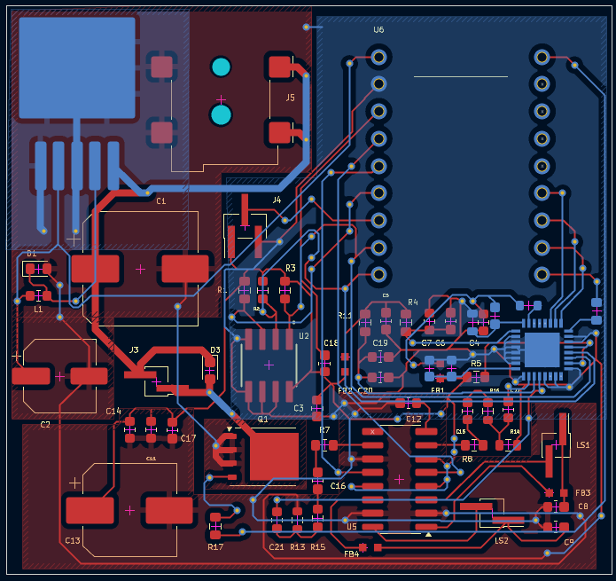
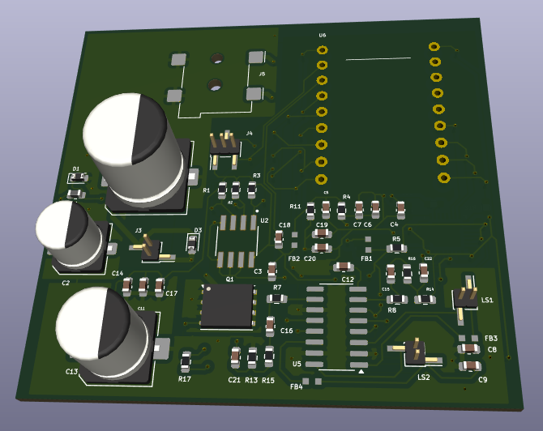
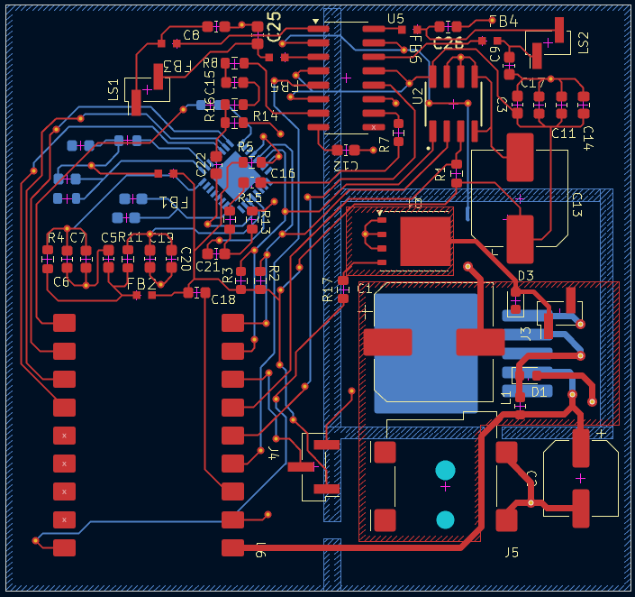
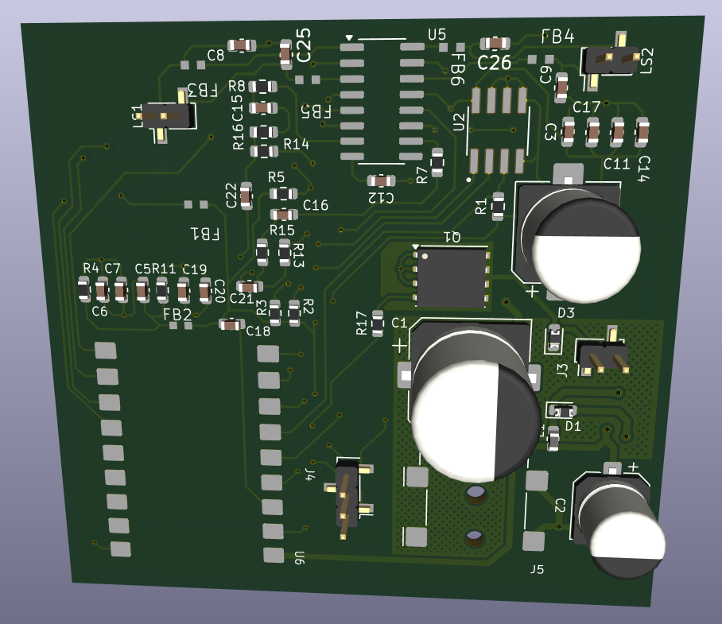
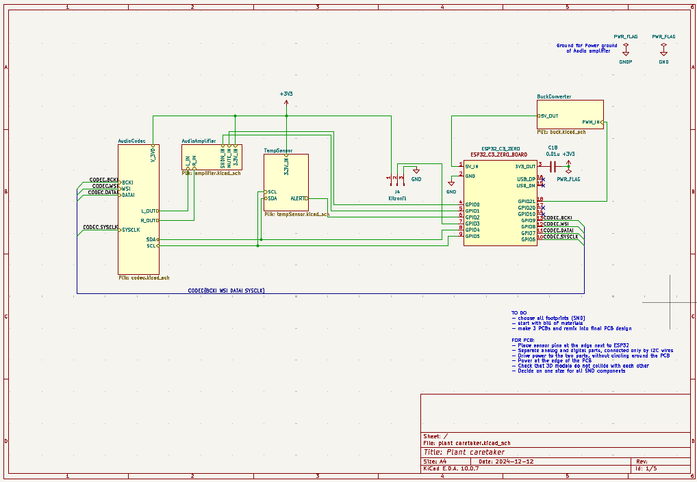

# Plant Caretaker PCB Design

A team PCB design project developed in KiCad at Poznan University of Technology. The circuit combines an ESP32-C3 module with power conversion, temperature sensing, audio circuitry and a pump connection. We developed the schematic, individual PCB layouts and the final manufacturing files.

**Team members:** Martyna Rydczak, Dario Zandevakili and Maciej Jaśtak  
**Poznan University of Technology**

**KiCad · Schematic design · PCB layout · Custom footprints · Routing · Copper pours · BOM · Gerber files**

## Project overview

We created the initial schematic together, then developed separate PCB layout variants for review with the course instructor. Both my layout and Dario's received positive feedback. We selected Dario's layout as the basis for the final board because it was easier to incorporate the recommended changes.

We then completed the final design collaboratively, including further layout revisions and the preparation of Gerber and drill files. The project received the maximum grade.

## My contribution

> I co-developed the initial schematic and was responsible for the complete development of my PCB layout on the **MartynaPCB** branch. My work included footprint preparation, component placement, routing, copper pours and revisions following the instructor's feedback. I also prepared approximately half of the bill of materials and contributed to completing the final team design.

## Team contributions

> Dario developed the **DarioPCB** layout, which became the basis for the final board. Maciej worked on a separate layout variant and participated in the initial schematic development and team work. We completed the final design together.

### My PCB design

<table>
<tr><th width="50%">PCB layout</th><th width="50%">3D preview</th></tr>
<tr>
<td align="center"></td>
<td align="center"></td>
</tr>
</table>

## Final team design

The **main** branch contains the final PCB developed from Dario's layout. Subsequent revisions included changes to routing, copper zones, component footprints and ground connections, including a net-tie connection in the audio-amplifier circuit.

<table>
<tr><th width="50%">PCB layout</th><th width="50%">3D preview</th></tr>
<tr>
<td align="center"></td>
<td align="center"></td>
</tr>
</table>

---

<strong>Circuit schematic</strong>

The circuit is organised into hierarchical sheets covering power conversion, temperature sensing, the audio codec and the audio amplifier, connected through the main schematic.

---

<strong>Project versions</strong>

| Branch | Design version |
|---|---|
| [main](https://github.com/Mirginia0/Plant-Caretaker-PCB-Design/tree/main) | Final team design, including Gerber and drill files |
| [MartynaPCB](https://github.com/Mirginia0/Plant-Caretaker-PCB-Design/tree/MartynaPCB) | My individual PCB layout and subsequent revisions |
| [DarioPCB](https://github.com/Mirginia0/Plant-Caretaker-PCB-Design/tree/DarioPCB) | Dario's individual layout before final team revisions |
| [MaciejPCB](https://github.com/Mirginia0/Plant-Caretaker-PCB-Design/tree/MaciejPCB) | Maciej's PCB layout variant |

---

<strong>Design files and bill of materials</strong>

The project includes the main schematic and separate sheets for power conversion, temperature sensing, the audio codec and the audio amplifier. Component symbols and footprints are included in the project libraries.

The **Bill of Materials.txt** file lists component quantities and values. The final design includes copper, solder mask, solder paste, silkscreen and board-outline Gerber files, together with plated and non-plated drill files.

---

<strong>Opening the project</strong>

Download the chosen branch and open **plant caretaker.kicad_pro** in KiCad. Use the Schematic Editor to inspect the circuit and the PCB Editor to inspect the board layout. Keep the supplied component libraries alongside the project files.

---

Original team repository: [RedZunder/Electronic-design](https://github.com/RedZunder/Electronic-design).
